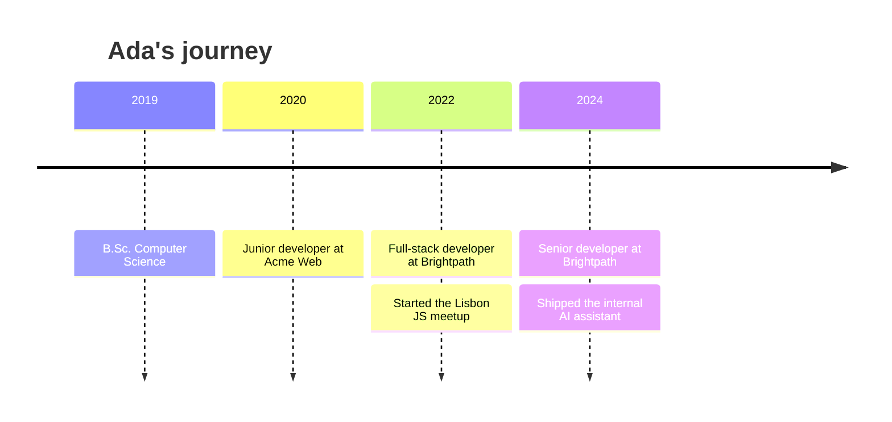
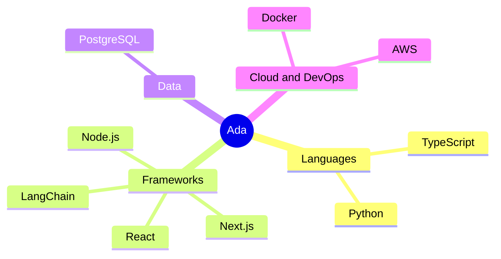

# Ada Example

**Full-stack developer · Lisbon, Portugal**

*Curious · Builder · Breaker of things*

▸ Click any section to expand it

<h3>👋 About</h3>

I build web apps and developer tools, and I like making complicated things feel small.

- Shipped an internal AI assistant used by 300 engineers
- Organizer of a local JavaScript meetup
- Currently building a local-first notes app and learning Rust

<h3>🧭 Career timeline</h3>

<b>Senior developer · Brightpath</b> (2024 to now)

- Led the internal AI assistant from prototype to 300 daily users
- Cut CI time from 25 to 8 minutes

<b>Full-stack developer · Brightpath</b> (2022 to 2024)

- Built the customer dashboard in Next.js and PostgreSQL
- Introduced end-to-end tests across the team

<b>Junior developer · Acme Web</b> (2020 to 2022)

- Shipped 20+ client sites in React

<h3>🧠 Skills map</h3>

<h3>🚀 Projects</h3>

| Project | What it does | Built with |
|---|---|---|
| **[tiny-queue](https://github.com/ada-example/tiny-queue)** | A 2 KB job queue for edge functions | TypeScript |
| **[PaperChat](https://paperchat.example.com)** | Chat with research papers you upload | Python · LangChain |
| **[dotfiles](https://github.com/ada-example/dotfiles)** | My terminal setup, documented | Shell |

<h3>📊 Activity</h3>

